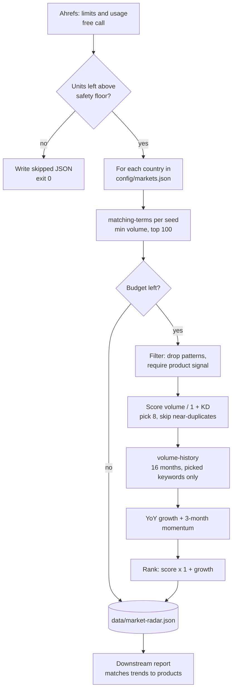

# Market Demand Radar: what people are searching for, by country, with growth, inside a fixed API budget

A weekly scan that answers a product-planning question with search data: which products are people looking for in each market, how hard is each term to rank for, and is demand rising or falling. It works across eight countries in their own languages and never spends more Ahrefs units than it is allowed.

## The problem

The business chose new products by looking at what competitors sold. That is a supply view. It shows what exists, not what buyers want, and it says nothing about markets where no competitor is active yet. Two things were missing:

- **Demand by country.** The same product can be flat in one market and climbing fast in another, under a different local name.
- **A trend, not a snapshot.** A keyword with 500 searches a month means something different if it had 200 a year ago.

The data was available through the Ahrefs API, but the API is metered and shared. Other workflows depended on the same monthly unit allowance, and an unbounded scan could starve them.

## What it does

`src/market-radar.js` runs once a week and writes `data/market-radar.json`:

1. **Pre-flight.** Reads the workspace's remaining units with a free call. If the allowance is below a safety floor, the run is skipped and says so.
2. **Gather.** For each country, queries matching terms for a few seed tokens. Local-language phrases that contain the seed come back automatically.
3. **Filter.** Keeps product-intent keywords only. Informational, review, marketplace and "near me" queries are dropped.
4. **Score.** `volume / (1 + difficulty)`, then picks up to eight keywords per country, skipping near-duplicates.
5. **Trend.** For the picked keywords only, pulls 16 months of volume history and computes year-over-year growth and three-month momentum.
6. **Rank.** Final order per country is the base score weighted by positive growth.

## Architecture



## Key design decisions

**The budget is enforced from real cost, not estimates.** After every call the script reads the unit cost from Ahrefs' response headers and adds it to a running total. Before every call it checks that total against `RADAR_UNIT_BUDGET`. When the budget is reached the run stops asking and writes what it has. If a cost header is ever missing, it falls back to a conservative one unit per row.

**It yields to other workflows.** A free quota call runs first. If the workspace has fewer units left than `RADAR_MIN_REMAINING`, the scan does not start. Discovery is the first thing to give way when the allowance is tight.

**It can never break what runs after it.** Every fatal path writes a valid JSON file with `skipped: true` and a reason, and exits 0. A report scheduled after the radar in the same workflow always finds a file it can read.

**Cheap calls first, expensive calls only for survivors.** Candidate gathering is one call per seed. Trend history is one call per keyword, so it runs only for the eight keywords per country that survived filtering and scoring.

**Near-duplicates are collapsed before trends are fetched.** Two keywords that share 80% of their tokens count as one. Without this, the eight trend calls for a country would go to eight word-order variants of the same phrase.

**Filters are multilingual and live in config.** Drop patterns and product signals are word lists in `config/markets.json`, covering every language the scan targets. Adding a market means adding a country entry and its local terms. No code change.

**Growth is computed on three-month windows.** The current partial month is dropped. Year-over-year compares the latest three full months with the same three a year earlier, and momentum compares them with the three before. Single-month noise does not create a trend.

## Repository layout

```
src/market-radar.js          quota check, gathering, filtering, scoring, trends, output
config/markets.example.json  countries, seeds, drop patterns, product signals
scripts/test-scoring.js      offline tests for filtering, scoring and de-duplication
.github/workflows/           weekly run, output uploaded as a workflow artifact
```

## Setup

Requires Node 20+ and an Ahrefs API v3 token.

```bash
npm install
npm test                                            # offline, no token needed
cp .env.example .env                                # add the token
cp config/markets.example.json config/markets.json  # your countries, seeds and word lists
npm run radar
```

| Variable | Purpose |
|---|---|
| `AHREFS_API_TOKEN` | Keywords Explorer and the quota endpoint |
| `RADAR_UNIT_BUDGET` | Hard cap on units spent in one run. Default 12,000 |
| `RADAR_MIN_REMAINING` | Skip the run if the workspace has fewer units than this left. Default 60,000 |
| `CONFIG_DIR`, `DATA_DIR` | Override the `config/` and `data/` locations |

The example config scans specialty coffee across eight countries. Output per keyword: volume, difficulty, CPC, traffic potential, year-over-year growth, momentum and a 12-point sparkline.

Scheduled runs are off by default. Set the repository variable `ENABLE_SCHEDULE` to `true` to turn the schedule on; manual runs from the Actions tab always work.

---

Extracted from a production automation suite I built and ran for a live e-commerce and B2B wholesale business, 2026.

© Michael Wootan. Source shared for portfolio review; all rights reserved.
